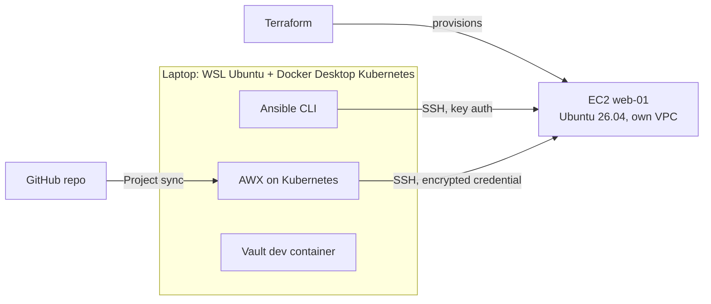
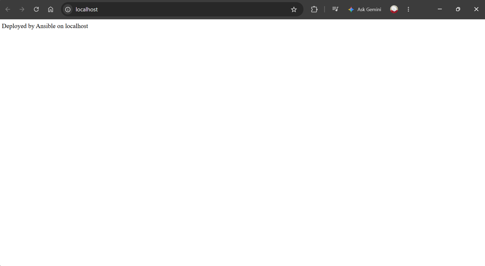
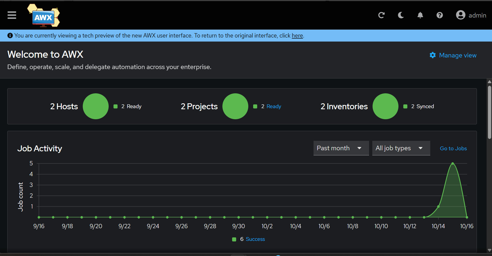
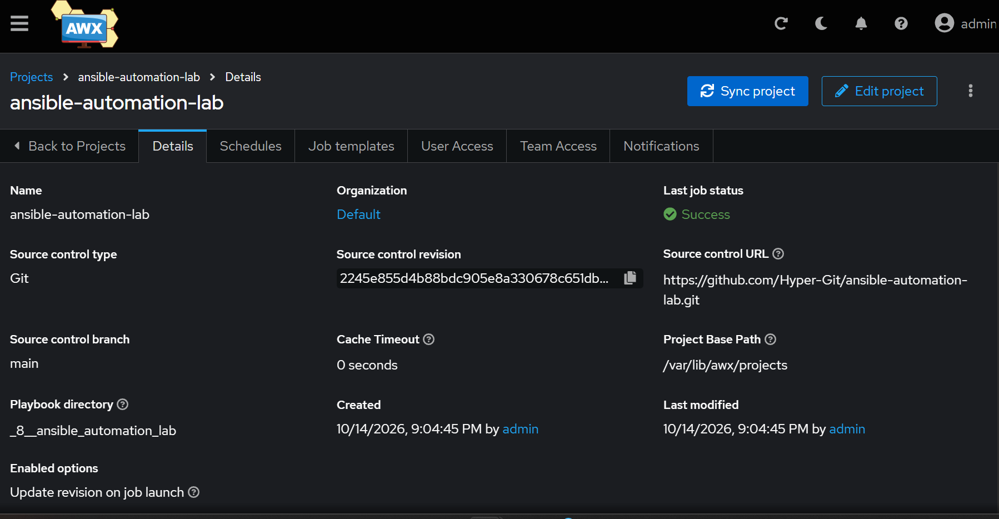
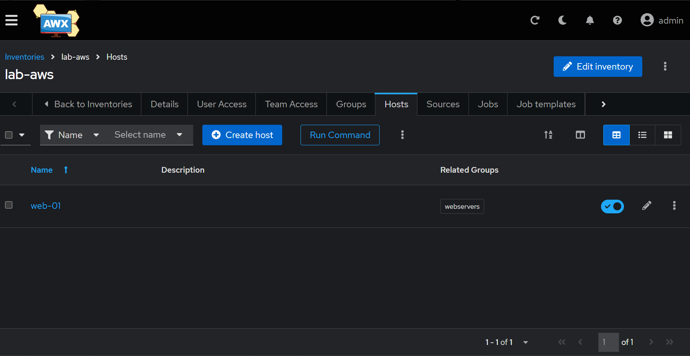
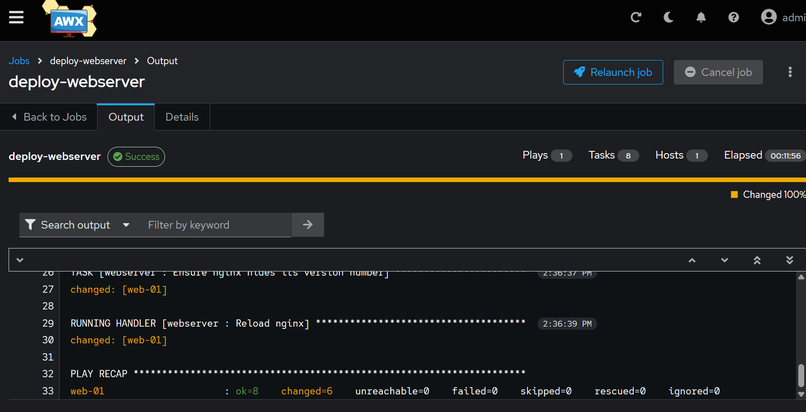
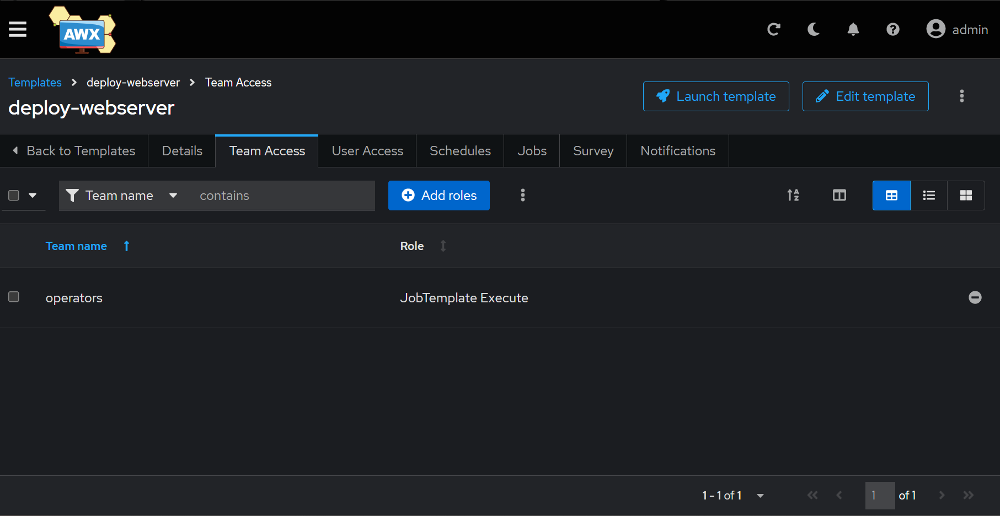
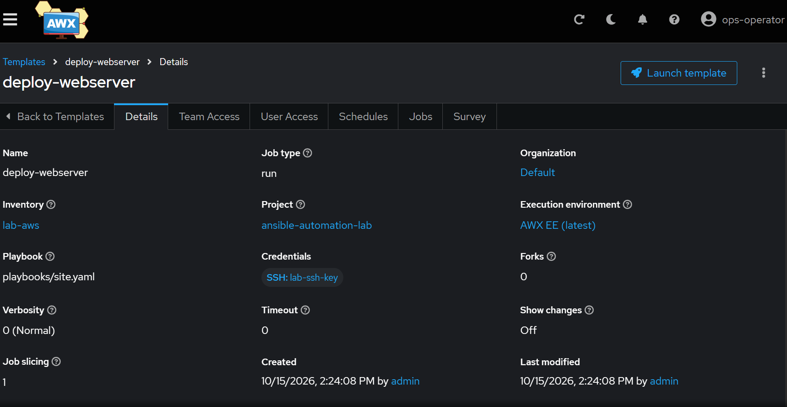
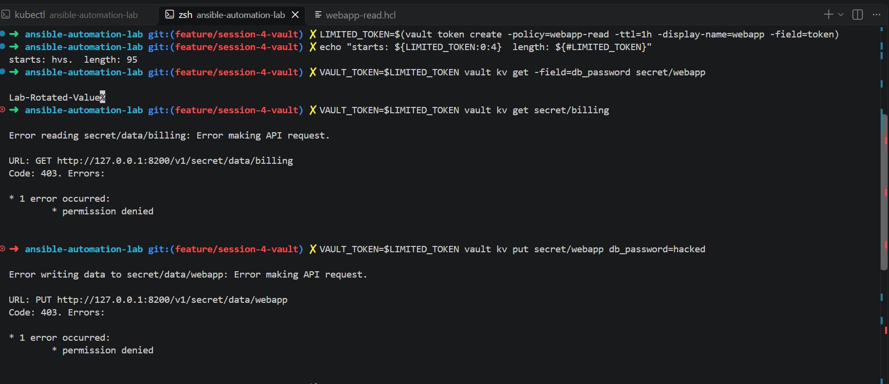
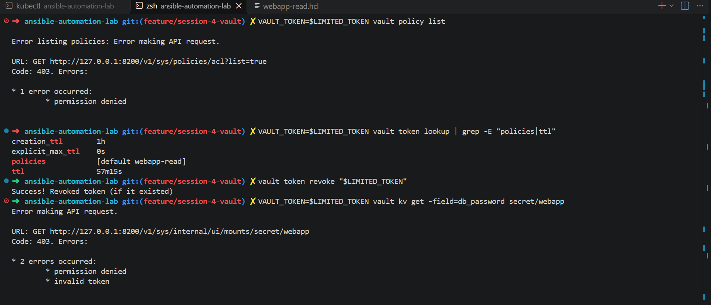

# ansible-automation-lab

A hands-on lab that provisions an AWS server with Terraform, configures it with Ansible, runs that configuration from AWX with role-based access control, and manages secrets in HashiCorp Vault with least-privilege policies.

I built it to get practical experience with the tools used by infrastructure operations and automation teams, and to practise working the way those teams do: small commits, pull requests, dry runs before changes, and evidence for every claim.

> **This is a personal learning lab, not a production system.** Some settings are deliberately lab-only and are called out below.

**Stack:** Ansible (ansible-core 2.21) · AWX 24.6.1 (AWX Operator 2.19.1) · HashiCorp Vault 2.2.0 · Terraform · AWS (VPC, EC2) · Kubernetes (Docker Desktop) · GitHub

---

## Architecture



| Tool | Job in this lab |
|---|---|
| **Terraform** | Builds the infrastructure: a dedicated VPC, public subnet, internet gateway, security group, key pair and one `t3.micro` EC2 (`web-01`) |
| **Ansible** | Configures the server: installs and runs nginx, creates a service user, creates a working directory, deploys a homepage and hardens nginx |
| **AWX** | Runs the same playbook from a web UI, pulling the code from GitHub, with an encrypted SSH credential and a team that can launch the job but not change it |
| **Vault** | Stores secrets with versioning, and issues short-lived tokens that can read only what their policy allows |

---

## Repository layout

```
ansible.cfg                 Ansible settings for this repo (inventory path, roles path)
inventory/hosts.yaml        Static inventory: local, aws and webservers groups
playbooks/site.yaml         Entry point: applies the webserver role to the webservers group
roles/webserver/            Reusable role: tasks, handler and default variables
terraform/                  VPC, security group, key pair and EC2 for the lab
awx/                        Kustomize install of the AWX Operator and the AWX instance
vault/policies/             Vault least-privilege policy
docs/screenshots/           Evidence for each stage
exercises/                  Extra practice playbooks
```

---

## What the playbook does

`playbooks/site.yaml` targets the `webservers` group and applies the `webserver` role:

1. Installs nginx (refreshing the apt cache only if it is older than an hour)
2. Ensures nginx is running and enabled at boot
3. Ensures a service user, `opsbot`, exists with a home directory
4. Ensures `/opt/ops-lab` exists, owned by `opsbot`, mode `0755`
5. Deploys a homepage showing which host was configured (`{{ inventory_hostname }}`)
6. Hides the nginx version number from response headers by setting `server_tokens off`, using `lineinfile` with `validate: nginx -t -c %s` so an invalid config can never be written
7. Reloads nginx through a handler, only when the configuration actually changed

Variables (`web_package`, `ops_user`, `ops_dir`) live in `roles/webserver/defaults/main.yml`, so they travel with the role whether it runs from the CLI or from AWX.

---

## How to run it

### Prerequisites
- WSL Ubuntu with Ansible installed (`pipx install --include-deps ansible`)
- Terraform and AWS credentials (this lab used temporary role credentials)
- Docker Desktop with Kubernetes enabled (about 10 GB RAM allocated to WSL for AWX)
- A lab SSH key: `ssh-keygen -t ed25519 -f ~/.ssh/ansible-lab`

### 1. Provision the server
```bash
cd terraform
# terraform.tfvars (git-ignored) contains: my_ip = "<your-ip>/32"
terraform init
terraform plan -out=tfplan
terraform apply tfplan
terraform output web_public_ip
cd ..
```
Put the IP in `inventory/hosts.yaml` as `ansible_host` for `web-01`.

### 2. Configure it with Ansible (CLI)
Always run from the repo root, so `ansible.cfg` is picked up.
```bash
ansible aws -m ansible.builtin.ping
ansible-playbook playbooks/site.yaml -l aws --check --diff   # preview
ansible-playbook playbooks/site.yaml -l aws                  # apply
```

*First playbook run, tested on localhost before EC2:*



### 3. Run it from AWX
```bash
kubectl apply -k awx/                                        # operator + AWX instance
kubectl get pods -n awx                                      # wait for web 3/3, task 4/4
kubectl get secret awx-lab-admin-password -n awx -o jsonpath="{.data.password}" | base64 --decode; echo
kubectl port-forward -n awx svc/awx-lab-service 8080:80      # then open http://localhost:8080
```
*AWX dashboard after setup:*



In AWX:

**Project:** this GitHub repo, branch `main`, update revision on launch. The synced revision matches the commit on `main`.



**Inventory:** `lab-aws`, group `webservers` (must match `hosts:` in the playbook), host `web-01` with `ansible_host` and `ansible_user: ubuntu`.



**Credential:** `lab-ssh-key` (Machine type, user `ubuntu`). The private key is stored encrypted and injected only for the duration of each job.

**Job Template:** `deploy-webserver` running `playbooks/site.yaml`. First run on a fresh server: `changed=6`, `failed=0`.



**Access:** team `operators` has the **Execute** role on the template; user `ops-operator` is a member.



*Logged in as `ops-operator`: the template can be launched but not edited.*



### 4. Vault
```bash
docker run -d --name vault-dev --cap-add=IPC_LOCK -p 8200:8200 hashicorp/vault
docker logs vault-dev 2>&1 | grep "Root Token"
read -rs VAULT_TOKEN && export VAULT_TOKEN                   # paste the token; it is never echoed or saved to history
alias vault='docker exec -i -e VAULT_ADDR=http://127.0.0.1:8200 -e VAULT_TOKEN vault-dev vault'

vault kv put secret/webapp db_password=Lab-Only-Not-Real api_key=lab-key-123
vault kv put secret/billing processor_key=billing-dummy-999
vault policy write webapp-read - < vault/policies/webapp-read.hcl
LIMITED_TOKEN=$(vault token create -policy=webapp-read -ttl=1h -field=token)
```

*The limited token reads its own secret, and is denied another team's secret, writes, and policy listing:*



*Token lookup shows only the `default` and `webapp-read` policies with a TTL counting down; after revocation the token is invalid:*



---

## How to verify

| Check | Command | Expected |
|---|---|---|
| Idempotency (CLI) | run the playbook twice | second run `changed=0` |
| Idempotency (AWX) | launch `deploy-webserver` twice | first run `changed=6`, second run `changed=0`, no handler |
| Homepage | `ssh ubuntu@<ip> curl -s localhost` | `Deployed by Ansible on web-01` |
| Hardening | `ssh ubuntu@<ip> "curl -sI localhost \| grep -i server"` | `Server: nginx` (no version) |
| nginx config valid | `sudo nginx -t` on the server | `syntax is ok`, `test is successful` |
| AWX RBAC | log in as `ops-operator` | can launch the template; no edit option; credential not visible |
| Vault least privilege | `VAULT_TOKEN=$LIMITED_TOKEN vault kv get secret/webapp` | allowed |
| | `... vault kv get secret/billing` | `403 permission denied` |
| | `... vault kv put secret/webapp ...` | `403 permission denied` |
| | `... vault policy list` | `403 permission denied` |
| Revocation | `vault token revoke "$LIMITED_TOKEN"`, then read again | `invalid token` |

Screenshots of each stage are in [`docs/screenshots/`](docs/screenshots/).

---

## How to roll back

| What | How |
|---|---|
| A bad playbook change | Revert the commit (`git revert`), push, and re-run the playbook. Preview with `--check --diff` first |
| A broken nginx config | Prevented by `validate`: Ansible refuses to write a config that fails `nginx -t`. A failed reload leaves nginx running on the previous config |
| A one-off bad file on servers | Ad-hoc cleanup, for example `ansible webservers -m ansible.builtin.file -a "path=<file> state=absent" --become`, rather than a permanent task in the playbook |
| The AWS infrastructure | `terraform destroy` (run after every session in this lab) |
| A leaked Vault token | `vault token revoke <token>`; tokens also expire on their TTL |
| A secret rotated to a bad value | KV v2 keeps versions: `vault kv get -version=<n> secret/webapp`, then put the good value back |
| AWX | `kubectl delete -k awx/` removes the instance and operator (this also deletes the AWX database) |

---

## Known issues and lessons learned

Real problems hit while building this, and how they were solved:

- **Ubuntu 26.04 uses `sudo-rs`.** Ansible could not recognise its password prompt and timed out on `become`. Diagnosed with `sudo --version`, then fixed by setting `ansible_become_exe: sudo.ws` (classic sudo) on `localhost` only. EC2 was unaffected because the `ubuntu` user has passwordless sudo.
- **Duplicate nginx directive broke a reload.** Ubuntu already sets `server_tokens` in `nginx.conf`, so adding it in a second file failed. nginx kept running on the old config, but the next restart would have failed. Diagnosed with `nginx -t` and `grep`, cleaned up with an ad-hoc command, and replaced with `lineinfile` plus `validate`.
- **Deprecated container registry.** AWX Operator 2.19.1 references `gcr.io/kubebuilder/kube-rbac-proxy`, which is being retired. Spotted before deploying by checking the rendered images, and overridden in Kustomize to `quay.io/brancz/kube-rbac-proxy:v0.15.0`.
- **AWX admin password rejected.** An API call (`401`) proved the password in the Kubernetes Secret did not match the database, probably because operator restarts interrupted setup. Fixed with `awx-manage update_password`.
- **Variables did not reach AWX.** `inventory/group_vars` only loads next to the inventory file in use; AWX uses its own inventory. Moved the variables into role defaults so they travel with the role.
- **Running from the wrong folder.** Ansible reads `ansible.cfg` from the current directory, so commands run inside `terraform/` found no inventory.
- **First AWX job was slow.** The execution environment image (about 700 MB) took 11 minutes to pull on first use; later jobs started in seconds.

Lab-only settings:
- `host_key_checking = False` in `ansible.cfg` (throwaway EC2 instances). In production this stays on.
- Vault in **dev mode**: in-memory storage, starts unsealed, HTTP, root token. Never used in production.

---

## Security notes

- No secrets in the repository: `terraform.tfvars`, Terraform state, saved plans, private keys and Vault tokens are all git-ignored, and the full Git history was checked before the repo was made public.
- SSH is allowed only from a single IP (`/32`). Port 80 is not exposed; the homepage is verified from inside the server.
- The SSH key is stored in AWX as an encrypted credential: users can run jobs with it but cannot view it.
- Vault tokens are short-lived (1 hour) and scoped to one read-only path.

---

## Future improvements

- Dynamic inventory with the `amazon.aws.aws_ec2` plugin, so new instances are found by tag instead of editing IPs
- Pin the AWX execution environment image instead of `awx-ee:latest`
- Have Ansible fetch secrets from Vault at run time (`community.hashi_vault`), so no secret is ever stored with the code
- Use Ansible Vault for the local sudo password instead of typing `-K`
- Connect through AWS Systems Manager instead of SSH, removing port 22 entirely
- CI checks on pull requests: `ansible-lint`, `terraform fmt -check` and `terraform validate`
- Vault in a non-dev configuration: persistent storage, TLS and auto-unseal
